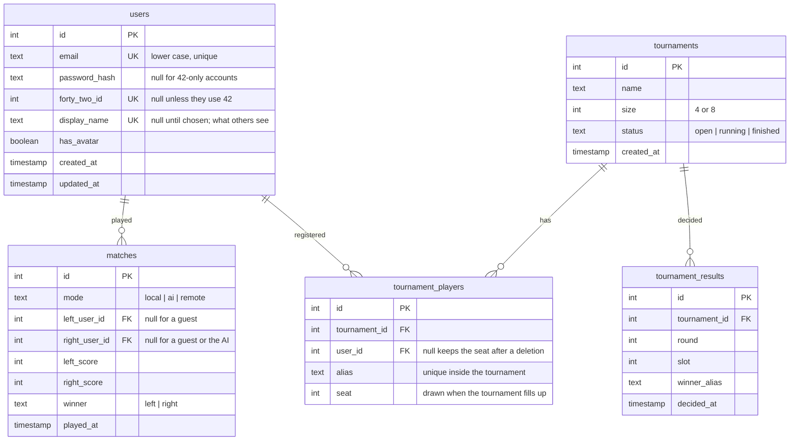

_This project has been created as part of the 42 curriculum by a four-person team._

# ft_transcendence

## Description

**ft_transcendence** is a web platform for playing Pong: against a friend on the same keyboard, against an AI, against another player over the network, or in a knock-out tournament. It is a single-page application served over HTTPS, with accounts, profiles and a match history, and it runs with one command.

The game itself does not run in the browser. The browser sends key presses and draws pictures; the server runs the rules sixty times a second and tells both players what happened. That one decision shapes the whole project: nobody can win by editing JavaScript, and two players always see the same ball.

**Key features**

- Pong in the browser: two players on one keyboard, or one player against an AI with three difficulty levels.
- Online games between two accounts, with matchmaking, a pause when somebody loses their connection, and a forfeit if they do not come back.
- Knock-out tournaments for 4 or 8 players, with aliases, a drawn bracket, and results the server records itself when a bracket match is played.
- Accounts with email and password or with 42, display names, avatars, and a match history with wins and losses.
- Customisable games: ball speed, paddle size, points to win, bonuses on the field, and two themes.

## Instructions

### Prerequisites

- Docker with Docker Compose v2, GNU make and OpenSSL
- For development only: Node.js 24 LTS and pnpm 10 (`corepack enable` installs the right pnpm)

### Run the project

```bash
git clone <repository-url> ft_transcendence
cd ft_transcendence
make
```

On the first run, `make` creates `.env` from `.env.example` (with a random JWT secret), builds the images and starts everything. Then open **https://localhost:8443** and accept the self-signed certificate once. All settings (database credentials, ports, secrets) live in `.env`, and every variable is explained in `.env.example`.

Other commands: `make down` (stop), `make logs`, `make ps`, and `make re` (start from scratch, **deletes all data**).

### Development

Everything below needs Node 24 and pnpm 10 (`corepack enable`), and a database:

```bash
pnpm install
make db                 # PostgreSQL alone, in Docker
pnpm --filter @ft/api db:migrate   # first time only: creates the tables
pnpm dev                # API on :3001, website on :3000
```

Before pushing, the same checks CI runs:

```bash
pnpm lint               # ESLint, no warnings allowed
pnpm format:check       # Prettier
pnpm build              # core, then the API, then the website
pnpm test               # unit tests (Vitest)
pnpm --filter @ft/api test:e2e   # the API answering real HTTP requests
```

A `pre-commit` hook (husky + lint-staged) runs ESLint and Prettier on what you staged, so a commit that would fail CI usually fails before it exists.

## Resources

### References

- [NIST SP 800-63B](https://pages.nist.gov/800-63-3/sp800-63b.html) — the password rules we follow: length over composition, and a blocklist.
- [OWASP Password Storage Cheat Sheet](https://cheatsheetseries.owasp.org/cheatsheets/Password_Storage_Cheat_Sheet.html) — the Argon2id parameters.
- [Next.js App Router documentation](https://nextjs.org/docs/app) — server components, `proxy.ts` and route handlers.
- [NestJS WebSockets](https://docs.nestjs.com/websockets/gateways) — gateways, lifecycle hooks and message handlers.
- [Prisma with PostgreSQL](https://www.prisma.io/docs/orm) — schema, migrations and the generated client.
- [Gaffer On Games, "Fix Your Timestep"](https://gafferongames.com/post/fix_your_timestep/) — the fixed-step loop the server runs.
- [42 intranet OAuth documentation](https://api.intra.42.fr/apidoc) — the authorize and token endpoints.

### Use of AI

AI-assisted development tools were used during the project as supplementary development and research tools, including for implementation ideas, debugging, testing, and explaining technical concepts.

All generated suggestions were reviewed by the team and integrated only after being checked against the project's requirements and tested locally. Final design decisions, implementation choices, testing, and validation remained the responsibility of the team.

## Team Information

This project was developed collaboratively by a four-person team as part of the 42 curriculum.

The team worked across the application architecture, game engine, real-time communication, authentication, tournaments, AI opponent, customization, infrastructure, testing, and documentation.

Development was organised around feature branches and pull requests, with shared code ownership and peer review.

## Project Management

- **Organization:** The project was developed through short sprints and feature-oriented work. Team members worked on dedicated branches and opened pull requests for changes. Shared areas such as the game page and socket gateway were reviewed carefully because multiple features interact there.
- **Tools:** GitHub issues and pull requests, with the templates in `.github/` and the rules in `CONTRIBUTING.md`: small commits, a clean `pnpm lint`, and `pnpm test` before pushing.
- **Communication:** A Discord server was used for day-to-day communication, while pull requests were used to document changes and provide a place for technical review.

## Technical Stack

- **Frontend:** Next.js (React) with TypeScript and Tailwind CSS. The App Router gives us a single-page application where the browser's Back and Forward buttons work without us writing a router, and server rendering means the first HTML already knows who is logged in, so the header never flickers.
- **Backend:** NestJS with TypeScript, and Socket.IO for the real-time part. Nest's modules and dependency injection keep the game, the accounts and the tournaments apart, and its WebSocket gateway is the same class as a controller, so both speak to the same services.
- **Database:** PostgreSQL through the Prisma ORM. Prisma's schema is the one description of the data, it generates the types the API is compiled against, and its migrations are files in the repository rather than hand-written SQL.
- **Other:** nginx (HTTPS reverse proxy, the only port exposed), Docker Compose, zod (the validation rules the browser and the server share), Argon2id (password hashing), Vitest (tests), Prettier and ESLint.

**The two choices that shaped everything else**

1. **A monorepo with a shared `@ft/core` package.** The game rules, the message shapes and the validation schemas live there, so the browser and the server cannot disagree about them: the same `step()` runs on the server, in the AI simulation and in the tests, and the same schema validates a form in the browser and a request on the server.

2. **A server-authoritative game.** The browser sends key presses and draws snapshots; it never decides where the ball is. This is what makes an online game fair, and it is why the same engine can drive a local game, an AI game and a tournament match.

## Database Schema



Two things worth noticing. **Users are optional on both sides of a match**: a local game or a game against the AI may have nobody logged in, and deleting an account leaves the games it played in place with a null player instead of erasing somebody else's history.

**The bracket is not stored**: it follows from the seats and the results, and `tournament/bracket.ts` rebuilds it whenever it is needed, so there is no second copy that could disagree.

## Features List

| Feature              | Description                                                                                                                                                          |
| -------------------- | -------------------------------------------------------------------------------------------------------------------------------------------------------------------- |
| Pong on one keyboard | Two players, W/S and the arrow keys. The server runs the game; the browser draws it.                                                                                 |
| AI opponent          | Three levels. The AI looks at the field a few times a second, predicts where the ball will arrive, aims with a human-sized error, and adapts to the game's settings. |
| Online games         | A queue pairs two logged-in players into one room; both see the same ball, and each controls one paddle.                                                             |
| Pause and reconnect  | A dropped connection pauses the game for 30 seconds and keeps the seat; coming back resumes it, not coming back loses it.                                            |
| Tournaments          | 4 or 8 players register with an alias, the seats are drawn, and the bracket says who plays next. A bracket match played here reports its own result.                 |
| Game customisation   | Ball speed, paddle size, points to win, bonuses on the field, and two themes. The server refuses values that would ruin the game.                                    |
| Accounts             | Email and password (Argon2id, NIST rules, common passwords refused) or "Continue with 42". The session is an httpOnly cookie.                                        |
| Profiles             | Unique display name, uploaded avatar (checked by its first bytes) or a generated one, wins and losses, and the last games played.                                    |
| Legal pages          | A privacy policy and terms written about this project, linked from the footer and accepted at signup.                                                                |
| HTTPS everywhere     | nginx is the only exposed port; the website, the API and the sockets are all behind it.                                                                              |

## Modules

| Module (as named in the subject)                                            | Type  | Points | Justification and implementation                                                                                                                    |
| --------------------------------------------------------------------------- | ----- | -----: | --------------------------------------------------------------------------------------------------------------------------------------------------- |
| Use a framework for both the frontend and backend                           | Major |      2 | NestJS on the server (`apps/api`) and Next.js with React in the browser (`apps/web`), both in TypeScript.                                           |
| Use an ORM for the database                                                 | Minor |      1 | Prisma over PostgreSQL: `apps/api/prisma/schema.prisma` and the migrations beside it. No SQL is written by hand.                                    |
| Standard user management and authentication                                 | Major |      2 | Signup and login (`apps/api/src/auth`), Argon2id hashes, unique display names, avatars, wins/losses and match history on `/profile`.                |
| Implement remote authentication with OAuth 2.0 (42)                         | Minor |      1 | `apps/api/src/auth/forty-two`: the authorize redirect with a state cookie, the code exchange on the server, and linking by 42 id or verified email. |
| Implement a complete web-based game where users can play against each other | Major |      2 | The engine in `packages/core/src/game` runs on the server 60 times a second; the browser only draws snapshots on a canvas.                          |
| Remote players                                                              | Major |      2 | Matchmaking pairs two players into one room (`apps/api/src/game`), with pause, reconnection and forfeit when somebody drops.                        |
| Introduce an AI Opponent for games                                          | Major |      2 | `packages/core/src/ai`: looks at the field a few times a second, predicts the bounce, presses keys like a player, and adapts to the settings.       |
| Implement a tournament system                                               | Minor |      1 | 4 or 8 players, aliases, drawn seats, a bracket rebuilt from the results (`packages/core/src/tournament`), and games that report themselves.        |
| Game customization options                                                  | Minor |      1 | Ball speed, paddle size, points to win and bonuses travel inside the game state, so the browser draws exactly what the server simulates.            |
| **Total (14 required)**                                                     |       | **14** |                                                                                                                                                     |

Safety margin, in case a module is not accepted during the evaluation:

| Module (as named in the subject)                                    | Type  | Points | Justification and implementation                                                                                               |
| ------------------------------------------------------------------- | ----- | -----: | ------------------------------------------------------------------------------------------------------------------------------ |
| Implement real-time features using WebSockets or similar technology | Major |      2 | Socket.IO over `wss://` through nginx: the state of every running game, matchmaking, pause and resume, and the ping indicator. |

## Development Contributions

The project was developed collaboratively, with different parts of the system being implemented and reviewed as the application evolved.

The main areas of development included:

- **Application architecture and infrastructure:** monorepo setup, pnpm workspaces, the shared `@ft/core` package, TypeScript configuration, ESLint and Prettier, Docker Compose, nginx, HTTPS, and PostgreSQL/Prisma integration.
- **Backend foundations:** NestJS modules, validation, shared schemas, authentication infrastructure, API error handling, security headers, and service organisation.
- **User management:** signup and login, Argon2id password hashing, sessions, profiles, display names, avatars, match history, legal pages, and 42 OAuth authentication.
- **Game engine:** the server-authoritative Pong engine, game state, physics, paddle and ball behaviour, scoring, game configuration, and the browser canvas.
- **Real-time communication:** Socket.IO, matchmaking, online game rooms, pause and reconnect behaviour, forfeit handling, and state synchronisation between clients.
- **AI opponent:** multiple difficulty levels, prediction of ball movement, controlled aim error, and adaptation to game settings.
- **Tournaments:** tournament creation and registration, aliases, bracket generation, result recording, tournament game integration, and tournament progression.
- **Game customisation:** ball speed, paddle size, score limit, bonuses, and visual themes.
- **Testing and validation:** unit tests, end-to-end API tests, linting, formatting, builds, browser testing, and integration testing of real-time functionality.
- **Documentation:** project documentation, technical decisions, development instructions, and README maintenance.

## Known limitations

- **Friends and online presence are not implemented yet.** The subject lists them under standard user management; everything else in that module is done.
- Tested in Chromium only. The subject asks for the latest Firefox, so that pass still has to be made.
- A tournament match waits for both players to press "Play now"; there is no timeout for somebody who never does.
- Results can still be entered by hand on the bracket page, for a match played elsewhere — which means they can also be entered wrongly.
- Avatars are stored as uploaded, without being resized.
- Online games always use the classic rules: two players would have to agree on anything else, and that conversation does not exist yet.
- Guests (not logged in) can play online games; they appear as "Guest" and their games are not saved in anyone's history.
